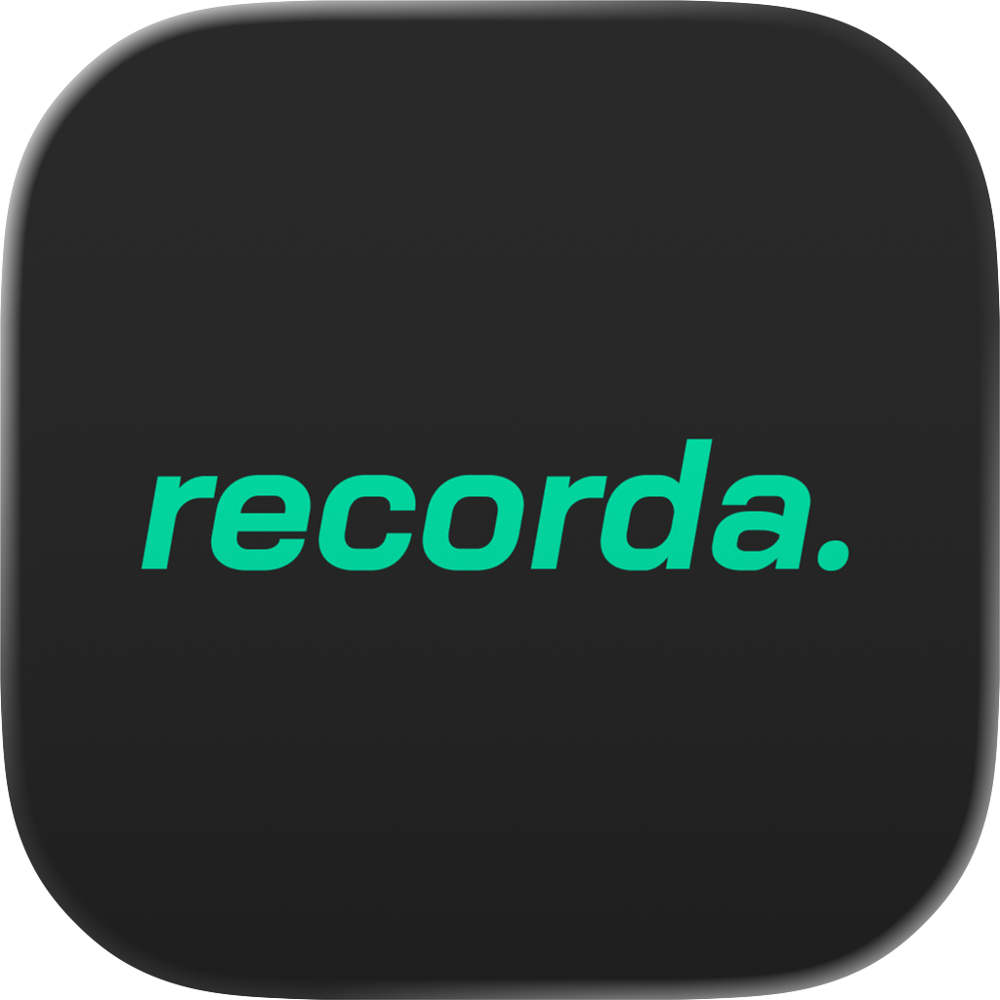
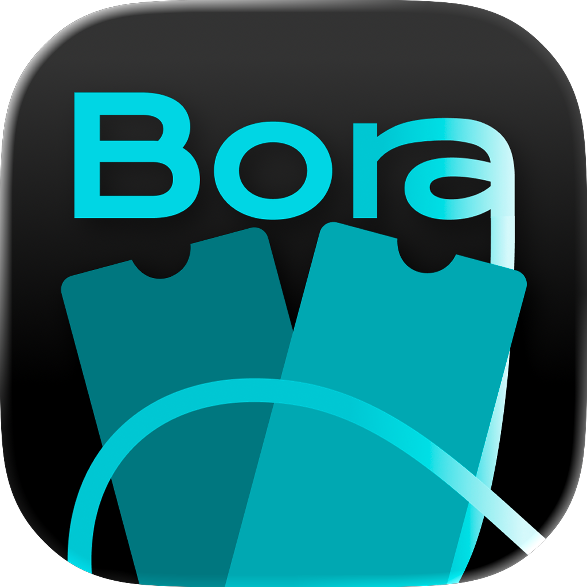
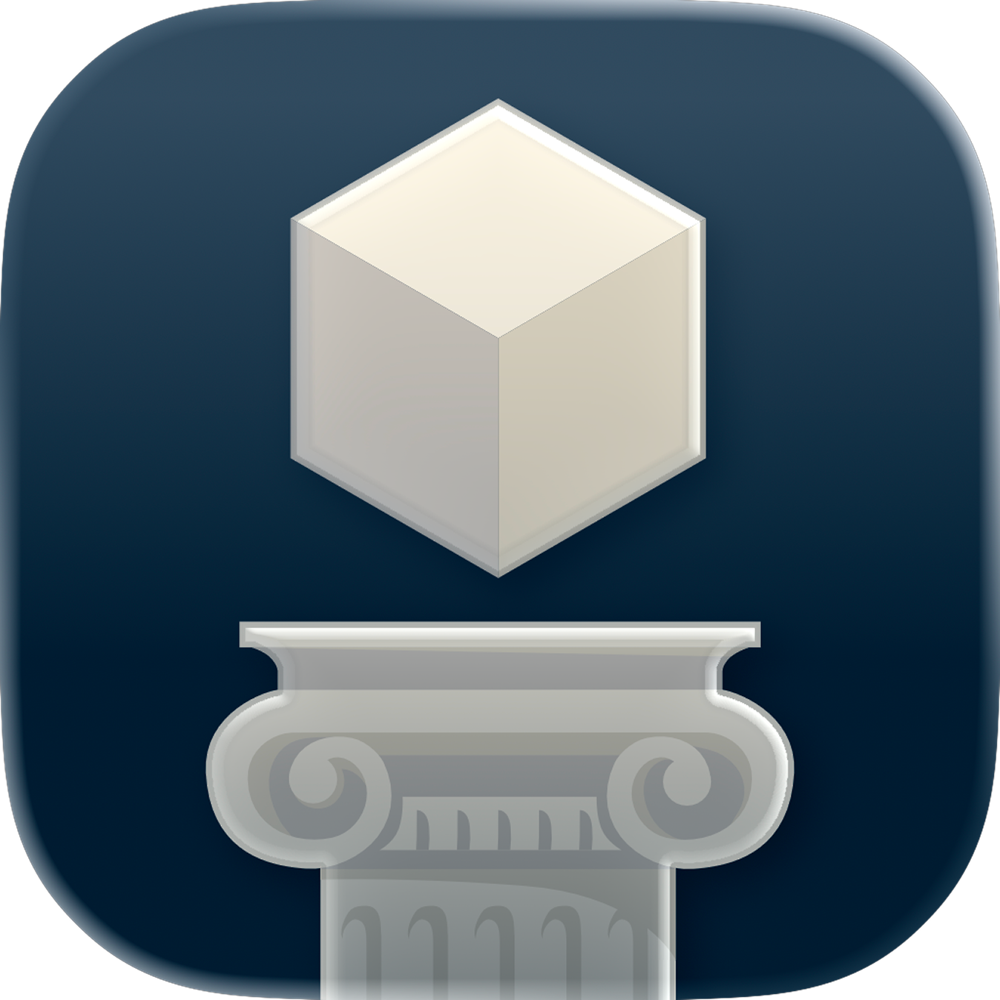
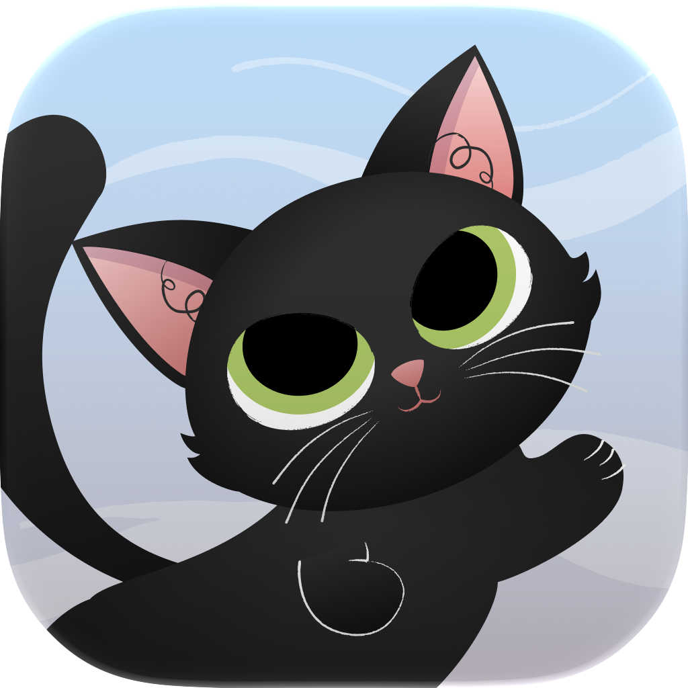
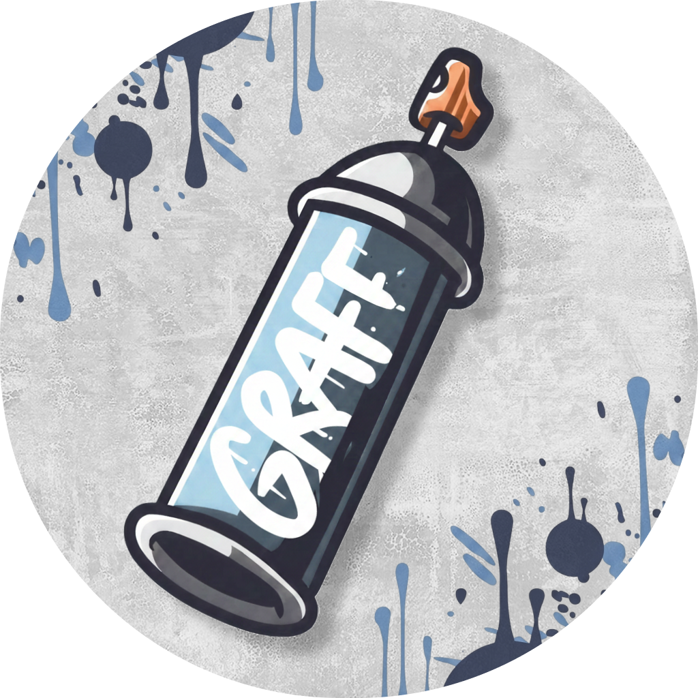
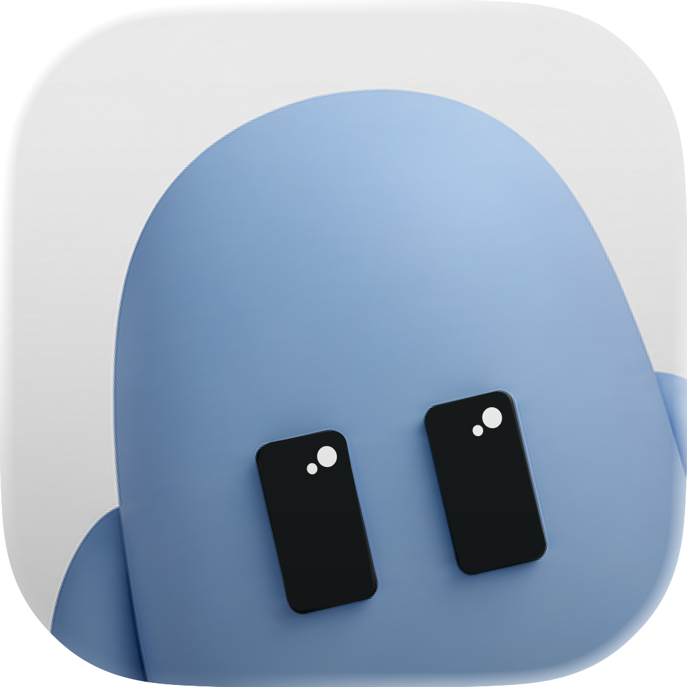
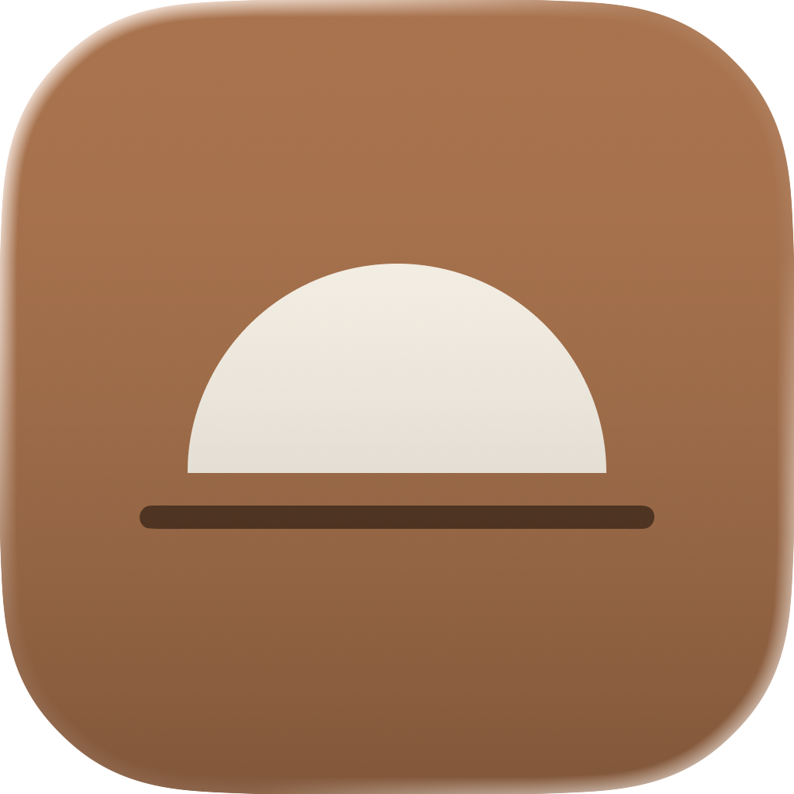
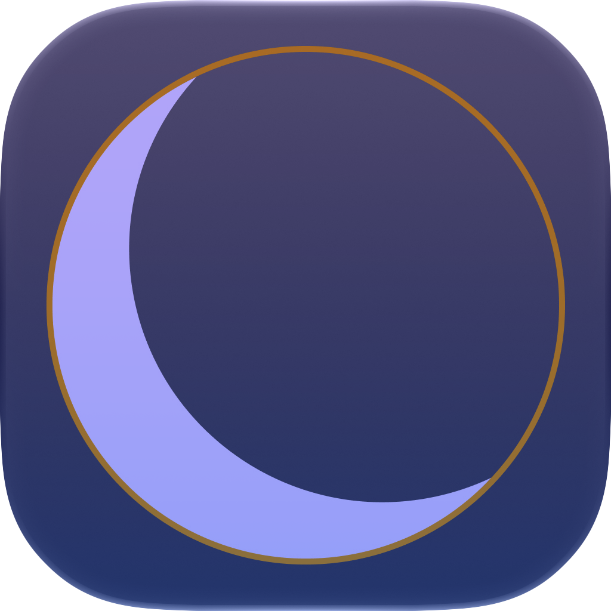

# Hey, I'm Eduardo Camana 👋

**iOS Developer | Mobile Engineer | Software Engineer**

I build native Apple experiences, turning ideas into products — from early prototypes to apps published on the App Store.

My main focus is **iOS development with Swift, SwiftUI, and UIKit**, with a strong interest in product engineering, intuitive interfaces, software architecture, and the Apple ecosystem.

📍 Porto Alegre, Brazil · 🇪🇺 Italian / EU Citizen  
🎓 Software Engineering @ PUCRS  
🍎 Apple Developer Academy (2025–2026)

---

## 🛠 Tech Stack

**iOS & Apple Platforms**  
Swift · SwiftUI · UIKit · SwiftData · CloudKit · XCTest · XCUITest

**Graphics, AR & Interactive Experiences**  
RealityKit · ARKit · SpriteKit · SceneKit · Game Center

**Web & Cross-Platform**  
React · TypeScript · Tailwind CSS · React Native · Flutter

**Backend & Integrations**  
Node.js · NestJS · Supabase · REST APIs

**Engineering & Tools**  
Git · GitHub · Figma · MVVM · Clean Architecture · SOLID

---

## 📱 Apps on the App Store

A collection of apps I've helped design, develop, and ship across the Apple ecosystem.

<table width="100%" cellspacing="0" cellpadding="14">
<tr>
<td width="33%" align="center" valign="top">
  
    
  <strong>Recorda.</strong>
   
  A music journal for capturing memories through albums and songs.
    
  <a href="https://apps.apple.com/br/app/recorda/id6747271327">App Store ↗</a>
</td>
<td width="33%" align="center" valign="top">
  
    
  <strong>Boraa</strong>
   
  Discover events, places, and experiences with friends.
    
  <a href="https://apps.apple.com/br/app/boraa/id6752790553">App Store ↗</a>
</td>
<td width="33%" align="center" valign="top">
  
    
  <strong>Glyptis</strong>
   
  Create and explore voxel sculptures in augmented reality.
    
  <a href="https://apps.apple.com/br/app/glyptis-realidade-esculpida/id6755839447">App Store ↗</a>
</td>
</tr>

<tr>
<td width="33%" align="center" valign="top">
  
    
  <strong>Tower of the Winds</strong>
   
  A mythology-inspired puzzle platformer powered by wind.
    
  <a href="https://apps.apple.com/gb/app/tower-of-the-winds/id6760729736">App Store ↗</a>
</td>
<td width="33%" align="center" valign="top">
  
    
  <strong>Grafittone</strong>
   
  Spatial graffiti and interactive music creation for Apple Vision Pro.
    
  <a href="https://apps.apple.com/us/app/grafittone-3d-paint-beats/id6797839879">App Store ↗</a>
</td>
<td width="33%" align="center" valign="top">
  
    
  <strong>Ennoa</strong>
   
  A private space for journaling and reflection between therapy sessions.
    
  <a href="https://apps.apple.com/br/app/ennoa/id6810774172">App Store ↗</a>
</td>
</tr>

<tr>
<td width="33%" align="center" valign="top">
  
    
  <strong>Bancada</strong>
   
  A smart cooking companion with recipe scaling and Apple Watch support.
    
  <a href="https://apps.apple.com/br/app/bancada/id6796044281">App Store ↗</a>
</td>
<td width="33%" align="center" valign="top">
  
    
  <strong>Somnus</strong>
   
  A private dream journal with voice recording and on-device intelligence.
    
  <a href="https://apps.apple.com/br/app/somnus/id6749871491">App Store ↗</a>
</td>
<!-- <td width="33%" align="center" valign="top">
  
    
  <strong>Cagada Remunerada</strong>
   
  A playful offline timer that calculates earnings during work breaks.
    
  <a href="https://apps.apple.com/br/app/cagada-remunerada/id6810780729">App Store ↗</a>
</td> -->
</tr>
</table>

---

## 🌐 Let's Connect

I'm interested in building meaningful products, exploring new technologies, and collaborating with people who care about the details.

